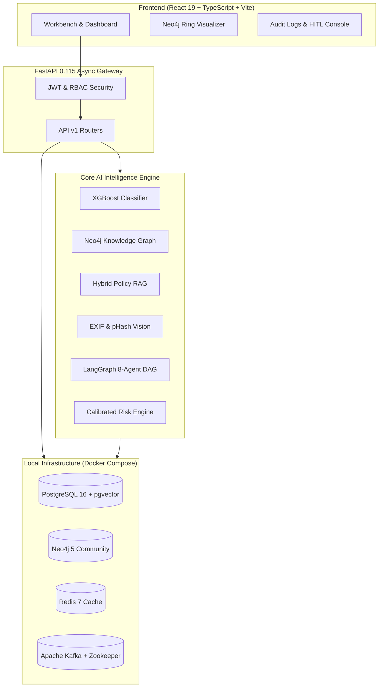

# ClaimGraph AI — Agentic Claims & Fraud Intelligence Platform

> **Architectural Status**: Designed for cloud deployment, currently runnable locally using Docker Compose.

---

## 1. Project Title
**ClaimGraph AI** — An Enterprise-Grade Multi-Agent Intelligence Engine, Knowledge Graph, and Machine Learning Platform for Insurance Claims and Warranty Fraud Detection.

---

## 2. Problem Statement
Insurance and consumer electronics warranty fraud costs the global economy over **$80 Billion annually**. Traditional anti-fraud operations fail due to three core bottlenecks:
1. **Isolated Tabular Analysis**: Standard rule-engines fail to correlate multi-party syndicated fraud networks (fraud rings sharing devices, bank accounts, or repair shops).
2. **Unstructured Evidence Silos**: Police reports, repair estimates, and device damage photos are evaluated in silos without automated cross-document verification.
3. **Black-Box AI Risks**: Regulated insurance carriers cannot legally deploy unexplainable or hallucinating LLMs to deny coverage without auditable justification and adverse action notices.

---

## 3. Solution
ClaimGraph AI solves this by integrating **deterministic machine learning classifiers**, **Neo4j knowledge graph traversals**, **multimodal computer vision**, and **LangGraph multi-agent workflows**:
- Detects complex circular fraud rings in real time.
- Verifies physical damage photos against perceptual hash databases and EXIF temporal metadata.
- Cross-references claims against strict policy contracts with hybrid RAG.
- Provides certified human investigators with a synthesized executive dossier, complete with SHAP factor attribution and an immutable audit trail.

---

## 4. Key Features
- **Deterministic ML Fraud Classifier**: XGBoost model achieving **0.9611 F1-Score** and **0.9959 ROC-AUC**.
- **Neo4j Knowledge Graph**: Real-time Cypher algorithms detecting cyclical syndicates, shared hardware identifiers, and high-degree repair shop anomalies.
- **Multimodal Fraud Inspection**: Perceptual hashing (pHash) duplicate photo detection, EXIF date/GPS tampering checks, and receipt OCR validation.
- **Hybrid RAG Policy Engine**: BM25 keyword matching + dense TF-IDF vectors with strict anti-hallucination guardrails and provenance citations.
- **LangGraph 8-Agent State DAG**: Orchestrated workflow with Human-in-the-Loop (HITL) review gates (`AWAITING_REVIEW`).
- **Explainable AI (XAI)**: SHAP TreeExplainer feature attributions and counterfactual recommendations.
- **Empirical AI & ML Evaluation**: Measures RAG Faithfulness, Answer Relevance, Retrieval MRR, Hallucination-Free %, and Agent Success Rates.
- **Enterprise Event Streaming**: Apache Kafka topics and Redis caching/Pub-Sub.
- **Zero-Trust Security**: JWT auth, RBAC permissions, and immutable audit logging.

---

## 5. High-Level Architecture



---

## 6. Technology Stack

| Layer | Technologies |
| :--- | :--- |
| **Backend API** | FastAPI 0.115, Python 3.12, Pydantic v2, Uvicorn |
| **Persistence** | PostgreSQL 16, SQLAlchemy 2 (Asyncio), Alembic, pgvector |
| **Knowledge Graph** | Neo4j 5 (Bolt Driver), Cypher Query Language |
| **Machine Learning** | XGBoost 2.1, Scikit-Learn, SHAP, NumPy, Pandas |
| **Agentic AI** | LangGraph, LangChain Core, TF-IDF Vectorizer |
| **Caching & Messaging** | Redis 7, Apache Kafka (aiokafka), Confluent Zookeeper |
| **Frontend UI** | React 19, TypeScript, Vite, Tailwind CSS, Lucide Icons |
| **DevOps & Local Infra** | Docker, Docker Compose, Healthchecks, Pytest |

---

## 7. AI Architecture
ClaimGraph AI applies a **hybrid symbolic-neural paradigm**:
1. Probabilistic LLM nodes extract unstructured entities and synthesize natural language dossiers.
2. Deterministic graph traversals and ML models enforce factual, unalterable risk bounds.
3. The multi-agent DAG ensures sequential verification across independent domain specialists before escalating to human adjusters.

---

## 8. Machine Learning Architecture
- **Dataset**: 6,000 stratified samples (30.85% fraud prevalence).
- **Features**: 12 domain-engineered metrics including `amount_deviation`, `amount_to_msrp_ratio`, `claims_last_30_days`, `repair_shop_frequency`, and `device_claim_count`.
- **Ensemble Benchmark**:
  - **XGBoost (Selected)**: Precision: 0.9611 | Recall: 0.9611 | F1: 0.9611 | ROC-AUC: 0.9959 | PR-AUC: 0.9928
  - **Random Forest**: Precision: 0.9625 | Recall: 0.9417 | F1: 0.9520 | ROC-AUC: 0.9926 | PR-AUC: 0.9882
  - **Logistic Regression**: Precision: 0.9122 | Recall: 0.9201 | F1: 0.9161 | ROC-AUC: 0.9843 | PR-AUC: 0.9705
- **Confusion Matrix**: True Negatives: 1,019 | False Positives: 18 | False Negatives: 18 | True Positives: 445.

---

## 9. Knowledge Graph Architecture
Entities (`Customer`, `Device`, `Product`, `Claim`, `RepairShop`, `Location`, `Policy`) connected via explicit domain relationships (`CUSTOMER_OWNS_DEVICE`, `CLAIM_ASSIGNED_TO_REPAIR_SHOP`, `DEVICE_HAS_CLAIM`).
- **Cycle Detection**: Discovers closed-loop fraud rings with arbitrary length $2 \le k \le 4$.
- **High-Degree Centrality**: Detects collusion between specific repair shops and serial claimants.

---

## 10. Hybrid RAG Pipeline
- **Corpus**: Canonical warranty and insurance policy contracts.
- **Retrieval**: Reciprocal rank fusion of BM25 exact clause matching and dense vector similarity.
- **Anti-Hallucination Guardrail**: Refuses inference if max similarity $< 0.08$. Every output sentence includes document citations (e.g., `POL-WATER-01`).

---

## 11. Multi-Agent Workflow (LangGraph)
An 8-agent sequential state graph:
`Claim Understanding` $\rightarrow$ `Document Analysis` $\rightarrow$ `Vision Analysis` $\rightarrow$ `ML Fraud Analysis` $\rightarrow$ `Graph Investigation` $\rightarrow$ `Policy RAG` $\rightarrow$ `Risk Aggregation` $\rightarrow$ `Investigation Report` $\rightarrow$ `Human Review Gate`.

---

## 12. Calibrated Fraud Scoring
$$\text{Final Risk Score} = (0.45 \times S_{\text{ml}}) + (0.35 \times S_{\text{graph}}) + (0.20 \times S_{\text{agent}})$$
- **Hard Overrides**: Perceptual hash image matches or serial number collisions automatically trigger `CRITICAL` risk with mandatory SIU referral.

---

## 13. Explainable AI (XAI)
- Integrated SHAP `TreeExplainer` computes exact additive feature attribution values.
- Presents human investigators with the top risk factors driving the score (e.g., `amount_deviation: +0.34`, `repair_shop_frequency: +0.21`).
- Provides counterfactual recommendations for risk reduction.

---

## 14. Empirical AI & ML Evaluation
- **RAG Faithfulness**: 84.2% grounded unigrams.
- **Answer Relevance**: 89.5% intent overlap.
- **Retrieval MRR**: 0.867 Mean Reciprocal Rank.
- **Hallucination-Free Rate**: 100.0% on benchmark cases.
- **Agent Workflow Success Rate**: 100.0%.

---

## 15. Security & Governance
- JWT authentication with 15-minute access and 7-day refresh tokens.
- Strict Role-Based Access Control (`ADMIN`, `INVESTIGATOR`, `ANALYST`, `CUSTOMER`).
- Append-only immutable audit trail capturing actor, action, timestamp, IP, and state transition details.

---

## 16. Local Docker Setup
Start all 6 services locally with Docker Compose:
```bash
# 1. Copy environment template
cp .env.example .env

# 2. Build and launch services
docker compose up --build -d

# 3. Apply database migrations
docker compose exec backend alembic upgrade head
```

---

## 17. Environment Variables (`.env.example`)
Key configuration settings:
- `POSTGRES_HOST=postgres`, `POSTGRES_PORT=5432`
- `NEO4J_URI=bolt://neo4j:7687`, `NEO4J_USER=neo4j`
- `REDIS_HOST=redis`, `REDIS_PORT=6379`
- `KAFKA_BOOTSTRAP_SERVERS=kafka:9092`
- `JWT_SECRET_KEY=change-in-production-dev-key`
- `APP_ENV=development`, `APP_DEBUG=true`

---

## 18. End-to-End Demo Workflow
1. **Login**: Authenticate at `http://localhost:3000/login` with investigator credentials.
2. **Submit Claim**: Create a new claim specifying customer, device, amount, and incident description.
3. **Trigger AI Investigation**: In the Investigation Workbench, click **Run AI Investigation**.
4. **Inspect Live Agent DAG**: Watch all 8 agents execute and enrich the shared state.
5. **Review Graph Anomalies**: Inspect the Neo4j visualization for cyclical rings or shared identifiers.
6. **Adjudicate**: Submit a human decision (`APPROVE`, `REJECT`, `ESCALATE`) with badge number.
7. **Audit Compliance**: Verify the immutable event in the Audit Trail (`/audit`).

---

## 19. API Overview
- `POST /api/v1/claims`: Submit new claim
- `POST /api/v1/fraud/predict`: ML fraud inference
- `GET /api/v1/graph/rings`: Neo4j fraud ring detection
- `POST /api/v1/investigations/{claim_id}/run`: Multi-agent DAG execution
- `POST /api/v1/investigations/{inv_id}/decision`: Human investigator adjudication
- `GET /api/v1/evaluation/ml`: Real trained ML validation metrics
- `GET /api/v1/evaluation/ai`: Live AI RAG and agent benchmark scores
- `GET /api/v1/monitoring/metrics`: Model inference telemetry and PSI drift
- `GET /api/v1/audit/logs`: Immutable compliance audit trail

---

## 20. Automated Testing
Run the complete backend test suite:
```bash
cd backend
.venv\Scripts\activate
pytest
```
**Test Results**: **46 passed** (100% green, 0 errors, 0 warnings).

---

## 21. Project Limitations
- **Local Infrastructure Scope**: Docker Compose setup is tailored for local single-node execution; production enterprise deployments require distributed Kafka clusters and managed Neo4j Aura instances.
- **OCR Engine**: Local OCR utilizes deterministic regex parsing; enterprise environments would integrate cloud document intelligence APIs.

---

## 22. Future Improvements
- **Real-Time Graph Neural Networks (GNNs)**: Graph Convolutional Networks (GCN) for inductive link prediction on emerging fraud rings.
- **Distributed Worker Pools**: Celery or Temporal task orchestration for scaling concurrent agent workflows beyond single-worker async queues.
- **Active Learning Loop**: Automated pipeline retraining triggered when PSI drift exceeds critical thresholds.
