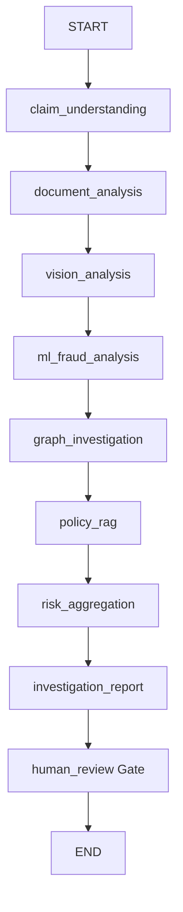

# ClaimGraph AI — Multi-Agent LangGraph Workflow

> **Workflow Thesis**: Autonomous single-agent prompts fail on multi-step enterprise workflows. A stateful DAG of specialized agents with shared typed state and human-in-the-loop gates provides predictable, auditable investigation traces.

---

## 1. The 8 Specialized Agents

1. **Claim Understanding Agent**: Parses raw incident narratives, extracts entity mentions, claim types, and declared damage.
2. **Document Analysis Agent**: Inspects uploaded receipts, police reports, and estimates for layout inconsistencies and altered figures.
3. **Vision Analysis Agent**: Analyzes device photos using perceptual hashing (pHash duplicate detection) and EXIF metadata validation (date/GPS tampering).
4. **ML Fraud Analysis Agent**: Computes feature vectors and executes XGBoost inference with SHAP factor extraction.
5. **Graph Investigation Agent**: Traverses Neo4j for syndicate rings, shared hardware identifiers, and high-degree repair shop connections.
6. **Policy/RAG Agent**: Retrieves relevant contractual clauses and identifies coverage exclusions or deductible conditions.
7. **Risk Aggregation Agent**: Calibrates the multi-factor risk score using deterministic weighting rules.
8. **Investigation Report Agent**: Synthesizes all agent findings into a structured, human-readable executive dossier with actionable recommendations (`APPROVE`, `REJECT`, `ESCALATE`).

---

## 2. LangGraph DAG Definition

---

## 3. Human-in-the-Loop (HITL) Adjudication

- High and critical risk claims enter `AWAITING_REVIEW` state.
- Certified human investigators review the dossier, examine evidence, and register an immutable decision (`APPROVE`, `REJECT`, `ESCALATE`) along with badge number and notes.
- The action triggers an audit log and downstream Kafka events (`claim.reviewed`, `claim.approved`, `claim.rejected`).
