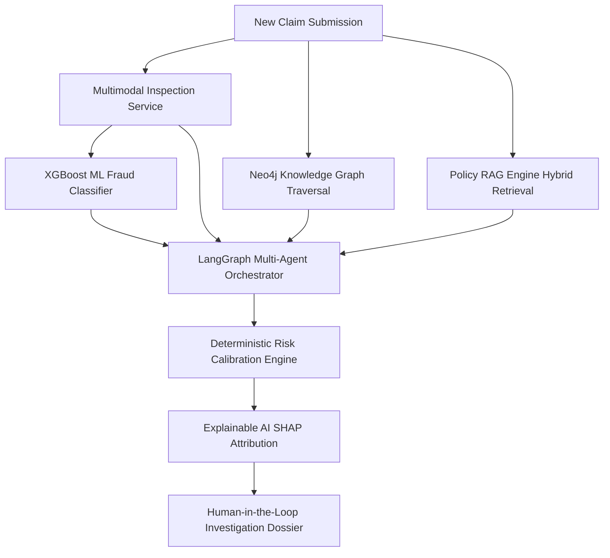

# ClaimGraph AI — AI System Architecture & Interview Guide

> **Core Architectural Philosophy**: Deterministic safeguards wrap probabilistic intelligence. LLMs provide reasoning, contextual extraction, and synthesis; deterministic ML classifiers and knowledge graph traversals enforce hard risk boundaries and unalterable facts.

---

## 1. System Overview

ClaimGraph AI employs a multi-tiered AI architecture designed for mission-critical enterprise insurance and warranty fraud intelligence.

---

## 2. Deep Dive: Key Interview Architectural Questions

### Q1: Why combine Machine Learning (ML) and Large Language Models (LLMs) together?
* **Failure mode of pure LLMs**: Hallucinations, non-deterministic probability estimates, inability to reliably calculate risk percentiles on tabular feature distributions, high cost and inference latency ($0.01+/call vs $0.0001).
* **Failure mode of pure ML**: Black-box scores without semantic grounding, inability to comprehend nuanced claim narratives, unstructured repair invoices, or complex insurance policy clause conditions.
* **The Synergy**: 
  - **XGBoost** computes calibrated mathematical probabilities (`P(Fraud | X)`) on tabular history (claim amount deviation, claim frequency, repair shop centrality).
  - **LLM Multi-Agent System** performs semantic reasoning: verifies whether the incident story matches police report metadata, detects altered receipts, and synthesizes evidence into human-actionable dossiers.

---

### Q2: Why LangGraph for Multi-Agent Orchestration?
* **Stateful cyclic graphs**: Claim investigation is not a linear chain. If the Policy Agent discovers a discrepancy in the purchase date, control must branch back to the Document Intelligence Agent to re-scrutinize the receipt before proceeding to decisioning.
* **Human-in-the-Loop checkpointing**: LangGraph natively models interruptible states (`AWAITING_REVIEW`) where human investigators approve or reject without losing execution context.
* **Deterministic transitions**: State schemas are strictly typed with Pydantic (`InvestigationState`), eliminating hallucinated state variables.

---

### Q3: Why Neo4j Knowledge Graph instead of Relational SQL for Fraud Rings?
* **Join complexity**: In relational databases, discovering a 4-hop circular fraud ring (Customer A -> Phone B -> Repair Shop C -> Customer D -> Phone B) requires 5 to 7 expensive recursive SQL joins that degrade exponentially with scale (`O(N^k)`).
* **Index-free adjacency**: In Neo4j, traversing relationships is `O(1)` per pointer hop. Cypher pattern queries identify cycles and shared entity clusters in milliseconds regardless of total graph size.
* **Explicit semantics**: Entities (Customer, Device, RepairShop, Location, Policy) and relationships (`CUSTOMER_OWNS_DEVICE`, `CLAIM_ASSIGNED_TO_REPAIR_SHOP`) naturally match real-world fraud syndicate operations.

---

### Q4: Why Hybrid Retrieval (BM25 + Dense Embeddings + Graph Context) for RAG?
* **Dense vector limitations**: Embedding similarity frequently misses precise alphanumeric policy identifiers, section codes (e.g., `POL-WATER-01`), and exact numerical deductibles ($1,000 vs $500).
* **BM25 keyword strengths**: Perfect for exact alphanumeric clause matching and domain-specific terminology.
* **Graph context augmentation**: The Knowledge Graph provides relational grounding (e.g., what specific warranty tier is attached to this customer's device), allowing the RAG query to retrieve strictly relevant policy clauses.

---

### Q5: Why a Deterministic Risk Calibration Engine?
* Regulated insurance decisions **cannot** legally rely on unexplainable neural network whims.
* The Risk Engine combines three distinct signals using calibrated mathematical weights:
  $$\text{Final Risk Score} = (0.45 \times \text{ML Score}) + (0.35 \times \text{Graph Risk}) + (0.20 \times \text{Agent Heuristics})$$
* Hard policy overrides: Any verified pHash image duplication or falsified serial number triggers an automatic override to `CRITICAL` risk with mandatory referral to SIU (Special Investigation Unit).
