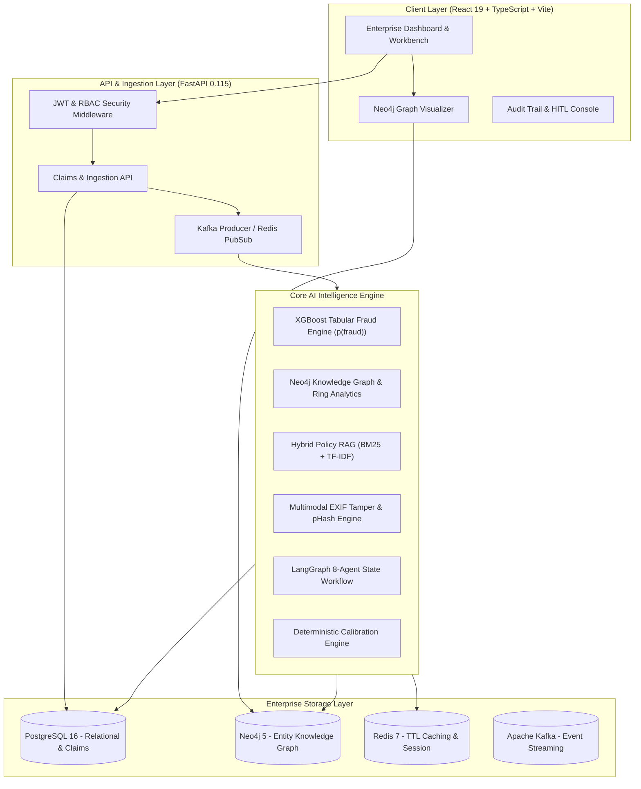

# ClaimGraph AI — High-Level System Architecture

> **System Thesis**: Enterprise claims and fraud operations demand low-latency tabular classification, relational fraud-ring detection, and grounded document intelligence wrapped in deterministic auditability.

---

## 1. End-to-End System Topology

---

## 2. Component Rationale — Senior Engineering Interview Justifications

### 1. Why FastAPI?
- Native async Python concurrency via `asyncio` allows non-blocking I/O across PostgreSQL, Neo4j Bolt driver, Redis, and Kafka.
- Pydantic v2 data validation guarantees strict contract verification at the ingress layer.
- Automatic OpenAPI documentation (`/docs`, `/redoc`) for enterprise integration.

### 2. Why PostgreSQL + Neo4j (Polyglot Persistence)?
- **PostgreSQL**: ACID compliance, relational integrity, row-level locking for transactions, user auth, and financial claim event transitions.
- **Neo4j**: Native graph storage with index-free adjacency. Exploring multi-party rings (e.g., 5 entities sharing a phone number across 12 claims) takes milliseconds in Cypher (`MATCH path=(c:Customer)-[*2..4]-(other)`) but degrades relational SQL databases with exponential joins.

### 3. Why Redis?
- Sub-millisecond caching for heavy analytics endpoints (`/api/v1/analytics/dashboard`).
- Rate limiting and short-lived session storage.
- Real-time Pub/Sub for live alert streaming to investigator dashboards.

### 4. Why Apache Kafka?
- Loose coupling between synchronous claim filing and asynchronous AI investigation workflows.
- Guaranteed message persistence and replayability for audit compliance in financial services.
- Event topics (`claim.created`, `ai.investigation.completed`, `claim.reviewed`) power downstream event-driven architectures.

### 5. Why Docker Compose for Local Execution?
- Eliminates cloud dependency and vendor lock-in for local development and technical evaluation.
- Reproducible environment across developer machines with built-in container health checks.
